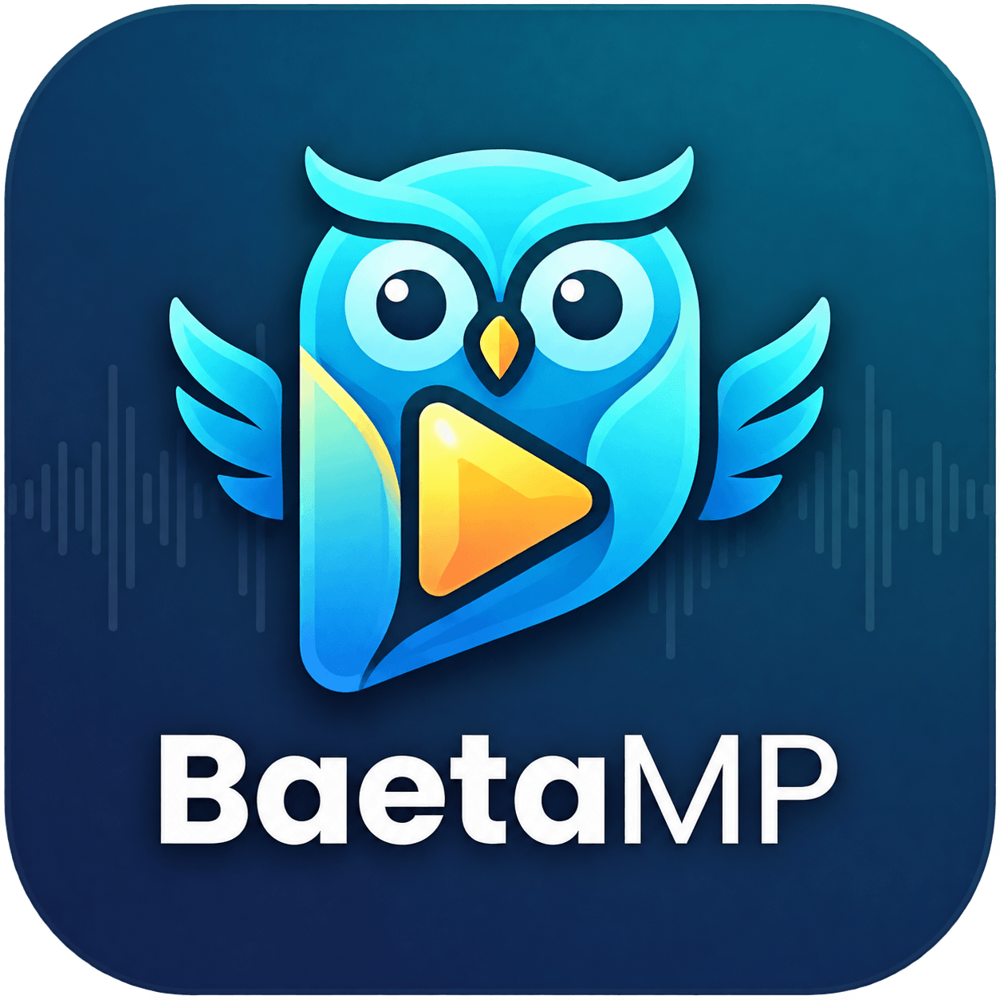
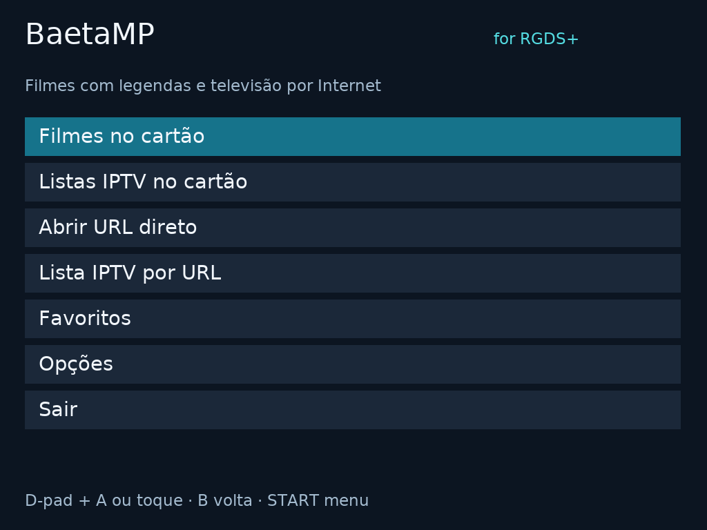

# BaetaMP



[⬇ Descarregar / Download](https://github.com/PolluxPT/BaetaMP/releases/latest)

# BaetaMP · Media Player for RGDS+

[English](README_EN.md) · [Instalação](docs/INSTALAR_PT.md) · [Compilação](docs/BUILD.md) · [Publicar no GitHub](docs/PUBLICAR_PT.md)

Leitor de filmes, legendas e IPTV para a **Anbernic RG DS+ com firmware Linux Stock**. Mantido por **Filipe Baeta**. Anteriormente chamado BaetaMediaPlayer; **MP significa Media Player**.

## Descarregar e instalar

Na secção **Releases**, descarrega **BaetaMP-v1.3.2-RGDSPlus.zip**, extrai-o e copia **o conteúdo da pasta `APPS`** para `Roms/APPS` do cartão Games/TF2. Abre **BaetaMP** no menu APPS. Não é necessário compilar.

Para o pacote instalável, usa o ZIP anexado à Release; o botão **Code → Download ZIP** descarrega o projeto para desenvolvimento.

O logótipo oficial está em **`APPS/Imgs/BaetaMP.png`**. O programa está em `APPS/BaetaMP/` e o lançador em `APPS/BaetaMP.sh`.

**Atualizar:** mantém as pastas antigas até abrir BaetaMP pela primeira vez. O lançador migra filmes, listas, favoritos, configurações e posições guardadas de `BaetaMediaPlayer` e `MediaPlayer_RGDSPlus`. Conflitos ficam preservados dentro de `BaetaMP/config/migracao-*`; lançadores antigos reconhecidos são arquivados. A migração não substitui um ficheiro já existente no destino.

## Funcionalidades

- Filmes locais e legendas externas associadas; ficheiro de demonstração 720p incluído.
- Listas IPTV M3U/M3U8 locais ou por URL, e abertura direta de endereços de vídeo/rádio.
- Favoritos de todas as fontes ordenados de A a Z, com remoção confirmada.
- Escolha de faixas de áudio e legendas por lista: idioma/título, marca da faixa atual e opção de legendas desligadas.
- Retoma de filmes com **Continuar / Ver do Início**.
- Menus **PT/EN**, com preferência guardada nas Opções.
- Três modos de imagem: proporção original, esticar e preencher com corte.
- Volume físico, avanço/retrocesso, iluminação do ecrã inferior e pedido de inibição do screensaver durante reprodução.
- Confirmação antes de sair e log único dentro da pasta da aplicação.

## Interface



## Controlos

| Ação | Controlo |
|---|---|
| Navegar / confirmar | D-pad + A, ou toque no ecrã inferior |
| Pausar / continuar | A durante o vídeo |
| Terminar vídeo | B durante o vídeo; numa lista de faixas, B apenas volta |
| Recuar / avançar 10 segundos | Esquerda/direita ou L/R nos filmes |
| Canal anterior / seguinte | L/R nas listas de rede/favoritos |
| Lista de áudio / legendas | X / Y, segundo os botões físicos confirmados na RG DS+ |
| Opções durante vídeo no superior | START |
| Apagar/acender ecrã inferior | SELECT, enquanto o vídeo está no superior |
| Volume | VOL+ / VOL− |

As listas de faixas também estão em **Legendas / Opções → Escolher áudio / Escolher legendas**. O menu de reprodução mantém quatro botões: Pausa, Legendas / Opções, Terminar Vídeo e Guardar Favorito.

## Compatibilidade e limites

Alvo diagnosticado: **RG DS+ Stock V1.0 (20260915), Linux ARM64/Wayland**, com SDL2/SDL2_ttf, libmpv 0.35.1 e libcurl do firmware. O ZIP não substitui estas bibliotecas. RG DS sem Plus, RG35XXSP e outros firmwares **não estão validados**.

**720p é o alvo de utilização.** O desempenho depende do codec, bitrate e descodificação disponível. Um vídeo 1080p abriu nos testes do utilizador, mas reproduziu lentamente. Não se promete reprodução fluida de todos os formatos.

É um leitor de ficheiros e streams, sem complementos ou autenticação/DRM de serviços comerciais. A disponibilidade dos canais depende do endereço e do serviço; RTP funcionou nos testes do utilizador, SIC/TVI não. Legendas gravadas na imagem não são faixas selecionáveis. Não são fornecidas listas IPTV ou credenciais.

## Desenvolvimento

Código em `src/`, testes em `tests/`, empacotamento em `tools/`. Instruções completas em [docs/BUILD.md](docs/BUILD.md).

```sh
make test
make arm64 test-arm64
make test-media test-http
make release test-package
```

O workflow GitHub verifica o projeto em Ubuntu 24.04, mas não publica Releases automaticamente. Consulta [VALIDATION.md](docs/VALIDATION.md) para distinguir os testes locais da validação física na consola.

## Licença e créditos

Código da aplicação: **GPL-3.0-or-later**, preservando a licença do projeto anterior. Ver [LICENSE](LICENSE) e [THIRD_PARTY_NOTICES.md](THIRD_PARTY_NOTICES.md). As declarações mpv/curl e a fonte DejaVu conservam os seus avisos próprios. O logótipo fornecido por Filipe Baeta é preservado no PNG original.

Na primeira utilização, a interface abre em inglês. Pode mudar para português nas opções; a escolha fica memorizada. Ao sair, o volume da consola regressa ao nível anterior à abertura do BaetaMP.
